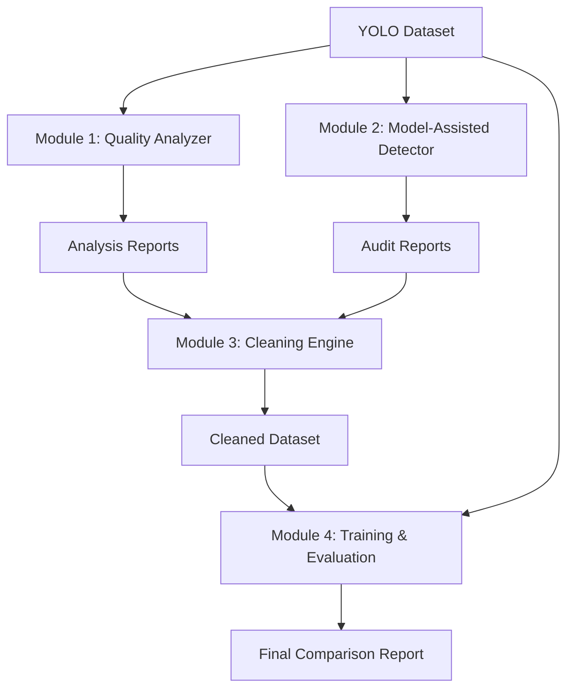

# Automated Annotation Quality Assurance & YOLO Retraining Pipeline

A modular, reproducible Python application that audits object detection datasets, detects annotation errors, generates a cleaned dataset, and measures the impact of annotation quality on YOLOv8 model performance.

## Project Overview

High-quality annotations are the foundation of robust computer vision models. However, real-world datasets frequently suffer from labeling errors such as missing objects, incorrect classes, shifted bounding boxes, and duplicates. This project provides a systematic, data-centric pipeline to identify, quantify, and mitigate these errors without requiring manual review of every single image.

## Problem Statement & Motivation

- **Problem**: Noisy annotations degrade model performance, but manual auditing of thousands of images is infeasible.
- **Motivation**: Automate the detection of suspicious annotations using geometric heuristics and model-assisted disagreement, then empirically prove that cleaning the dataset recovers lost model accuracy.

## Architecture

