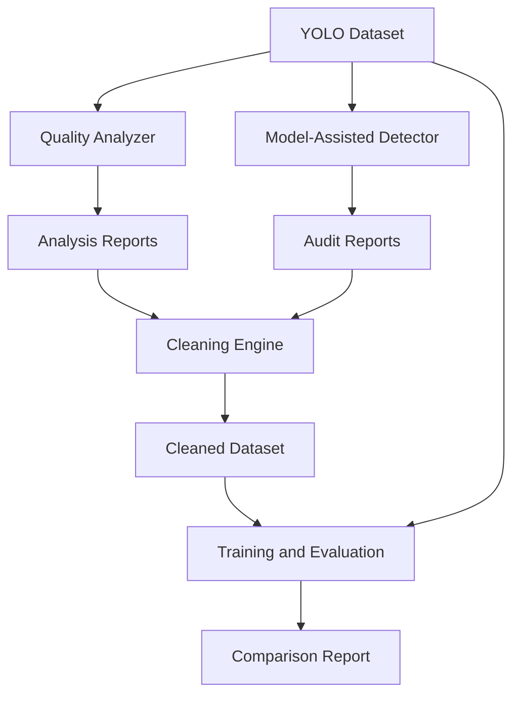

# Automated Annotation Quality Assurance & YOLO Retraining Pipeline

A modular, reproducible Python application that audits object-detection datasets, detects suspicious annotations, generates a cleaned dataset, and evaluates the impact of annotation quality on YOLOv8 model performance.

## Project Overview

High-quality annotations are essential for robust computer vision models. Real-world datasets can contain labeling errors such as missing objects, incorrect classes, shifted bounding boxes, and duplicate annotations.

This project provides a systematic, data-centric pipeline to identify, quantify, and mitigate suspicious annotations without requiring manual inspection of every image.

## Problem Statement & Motivation

- **Problem:** Noisy annotations can degrade model performance, while manually auditing thousands of images is time-consuming and difficult to scale.
- **Motivation:** Automate annotation quality checks using geometric heuristics and model-assisted disagreement detection, then evaluate how dataset cleaning affects model performance.

## Architecture



## Modules

1. **Dataset Quality Analyzer:** Performs rule-based geometric and statistical checks, including invalid coordinates, tiny boxes, extreme aspect ratios, duplicate boxes, and class imbalance.

2. **Model-Assisted Annotation Error Detection:** Uses pretrained YOLOv8 predictions and IoU-based greedy matching to identify potential missing annotations, class disagreements, and localization issues.

3. **Dataset Cleaning Engine:** Generates a separate cleaned copy of the dataset. Supports conservative and aggressive cleaning modes while preserving the original data. Only training labels are modified.

4. **Training, Evaluation & Reporting:** Supports a controlled three-way experiment comparing the original, synthetically corrupted, and cleaned datasets using consistent hyperparameters and an untouched validation set.

## Technology Stack

- Python 3.10+
- Ultralytics YOLOv8
- PyTorch
- OpenCV and NumPy
- Pandas
- Matplotlib and Seaborn
- PyYAML
- Pytest

## Installation

Clone the repository:

```bash
git clone https://github.com/Podiavaibhav/annotation-qa-yolo.git
cd annotation-qa-yolo
```

Create and activate a virtual environment.

**macOS / Linux**

```bash
python3 -m venv venv
source venv/bin/activate
```

**Windows**

```powershell
python -m venv venv
venv\Scripts\activate
```

Install dependencies:

```bash
pip install -r requirements.txt
```

## Dataset Preparation

The pipeline expects a YOLO-format dataset with a configuration file such as `data.yaml`.

Example structure:

```text
dataset/
├── images/
│   ├── train/
│   └── val/
├── labels/
│   ├── train/
│   └── val/
└── data.yaml
```

Ensure that `data.yaml` contains the correct dataset paths, class count, and class names.

## Usage

Run the complete pipeline:

```bash
python main.py run-all --data path/to/dataset/data.yaml
```

Alternatively, run individual modules:

**Analyze dataset quality**

```bash
python main.py analyze --data path/to/dataset/data.yaml
```

**Detect model-assisted annotation disagreements**

```bash
python main.py detect --data path/to/dataset/data.yaml --model yolov8n.pt
```

**Clean the dataset**

```bash
python main.py clean --data path/to/dataset/data.yaml
```

**Train and evaluate models**

```bash
python main.py train --data path/to/dataset/data.yaml
```

Replace the example dataset path with the path to your own dataset. These commands assume the corresponding CLI options are supported by the current implementation.

## Configuration

Configuration is maintained in `configs/default.yaml`.

Key parameters include:

- `tiny_box_threshold`: Minimum normalized bounding-box area; default `0.001`.
- `duplicate_iou_threshold`: IoU threshold used for duplicate-box detection; default `0.98`.
- `cleaning_mode`: Selects conservative or aggressive cleaning.
- `seed`: Random seed for reproducible noise injection; default `42`.

Refer to the configuration file for the actual available parameters and defaults.

## Experiment Methodology

The evaluation workflow compares three dataset conditions:

1. **Original:** Train on the original dataset.
2. **Noisy:** Train on a synthetically corrupted copy with configurable annotation errors, such as deletion, class flipping, coordinate shifts, resizing, and duplication.
3. **Cleaned:** Train on the noisy dataset after processing it through the cleaning engine.

All three models are evaluated on the same untouched validation set to enable a fair comparison.

The purpose is to measure whether the cleaning process improves downstream model performance rather than assuming that cleaning necessarily produces better results.

## Limitations

- Model-assisted detection depends on the pretrained model's capabilities and biases.
- Aggressive cleaning may remove legitimate annotations, including small or unusual objects.
- Synthetic annotation noise does not perfectly represent real-world labeling errors.
- Model disagreement is a signal for further inspection, not definitive proof that an annotation is incorrect.

## Future Improvements

- Integrate active learning to prioritize annotations for human review.
- Add COCO JSON support with automatic YOLO conversion.
- Develop an interactive dashboard for reviewing suspicious annotations.

