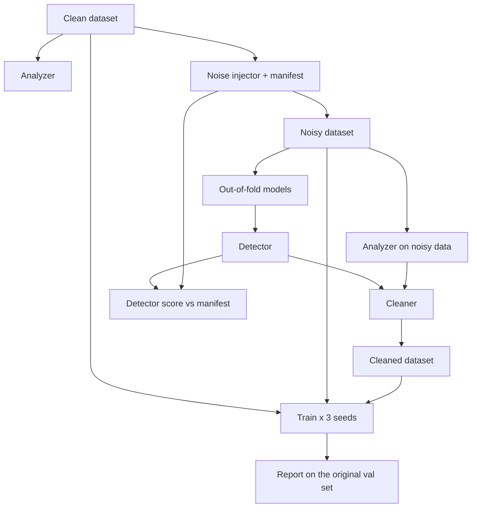

# Annotation QA for YOLO datasets

Bad labels hurt object detectors, and checking thousands of images by hand doesn't scale. This project finds suspicious labels automatically, builds a cleaned copy of the dataset, and measures whether training on the cleaned copy gives a better model.

To measure that fairly, the experiment corrupts a clean dataset on purpose and keeps a record of every change. That lets me ask two questions with real answers: how many of the planted errors did the detector find, and how much of the lost accuracy did cleaning win back.

## How it works

1. **Analyze.** Rule-based checks on the labels: invalid coordinates, tiny or oversized boxes, odd aspect ratios, duplicate boxes, class counts.
2. **Corrupt.** A noisy copy of the training labels is made by deleting boxes, flipping classes, shifting and resizing boxes, and adding duplicates. Every change is written to `corruption_manifest.json`. The validation set is never touched.
3. **Detect.** The images are split into folds. For each fold, a YOLO model is trained on the other folds' (noisy) labels and used to predict only the held-out fold. So no image is predicted by a model that trained on it. A model that has seen an image tends to repeat its wrong labels instead of disagreeing with them. Where a confident prediction disagrees with a label, the detector records the line number and the box coordinates.
4. **Score the detector.** The detector's flags are compared with the manifest: recall (how many planted errors were flagged) and precision (how many flags were real).
5. **Clean.** The cleaner works on one box at a time. Exact duplicates are removed (the first copy stays). In `model_assisted` mode it also relabels boxes with a confidently different predicted class, moves boxes the model places elsewhere, and adds boxes the model sees but nobody labeled.
6. **Train and compare.** YOLO is trained on the Original, Noisy and Cleaned data, three seeds each, and every model is evaluated on the same untouched validation set. The report gives mean ± standard deviation, and says so when a gain is smaller than the seed-to-seed variation.



## Setup

Python 3.10 or newer.

```bash
git clone https://github.com/Podiavaibhav/annotation-qa-yolo.git
cd annotation-qa-yolo
python3 -m venv venv
source venv/bin/activate        # Windows: venv\Scripts\activate
pip install -r requirements.txt
```

## Running it

Training needs a GPU to be practical. `notebooks/kaggle_experiment.ipynb` runs the whole thing on Kaggle (turn on the GPU and Internet in the notebook settings).

```bash
# 1. Download a dataset (any Ultralytics dataset yaml works) and write a yaml for it
python main.py prepare --dataset african-wildlife.yaml
# prints: Dataset ready. Use:  --data <path>/data.yaml

# 2. A quick check that everything runs (1 epoch, tiny images; the numbers mean nothing)
python main.py --config configs/smoke.yaml run-all --data <path>/data.yaml

# 3. The real run
python main.py run-all --data <path>/data.yaml
# interrupted? add --resume to reuse finished training runs
```

`run-all` writes everything under `outputs/`. The files to look at:

| File | What it holds |
|---|---|
| `outputs/experiments/final_report.md` | mAP for Original / Noisy / Cleaned, mean ± std over seeds |
| `outputs/experiments/detector_eval.md` | recall and precision of the detector against the planted errors |
| `outputs/experiments/comparison.csv` | the same numbers as a table |
| `outputs/cleaning/` | what the cleaner changed, line by line |
| `outputs/model_audit/` | every flag the detector raised, with box coordinates |

The individual steps can also be run on their own: `analyze`, `inject-noise`, `detect` (add `--oof` for out-of-fold models), `clean`, `score`, `train`.

## Cleaning modes

Set `cleaning_mode` in `configs/default.yaml`:

- `conservative`: removes invalid or malformed boxes and exact duplicates.
- `model_assisted` (default): also relabels, moves and adds boxes using the detector's output.
- `aggressive`: also deletes boxes the analyzer calls suspicious (tiny, extreme aspect ratio, huge). This can remove real small objects.

The confidence a prediction needs before it may change a label is set by `clean_relabel_confidence`, `clean_replace_confidence` and `clean_add_confidence`. Raising them makes the cleaner more careful.

## Dataset layout

The loader accepts `images/train` + `labels/train` and `train/images` + `train/labels`, and `val`, `valid` or `validation` for the validation split. A dataset yaml with a relative `path:` is fine; the pipeline writes its own copies with an absolute path before handing anything to Ultralytics.

## Results

The end-to-end annotation QA pipeline was successfully executed on the African Wildlife dataset, comparing YOLOv8n performance across original, synthetically corrupted, and cleaned datasets.

### Benchmark Summary

| Metric | Original | Noisy | Cleaned |
|---|---:|---:|---:|
| mAP50 | **96.73%** | 95.26% | 96.05% |
| mAP50-95 | **82.17%** | 79.21% | 80.68% |
| Precision | **95.14%** | 92.78% | 95.09% |
| Recall | **92.51%** | 90.49% | 91.08% |

*Mean results across three training seeds (42, 43, 44).*

### Annotation Error Detection

| Error Type | Detection Recall |
|---|---:|
| Missing annotations | 81.6% |
| Incorrect class labels | 74.1% |
| Localization errors | 71.8% |
| Duplicate annotations | 82.9% |

### Key Findings

- Recovered **53.6% of the mAP50 performance loss** introduced by synthetic annotation noise.
- Improved mAP50 from 95.26% (Noisy) to 96.05% (Cleaned).
- Achieved consistent mAP50 improvement over the Noisy condition across all three training seeds.
- Correctly restored 127 deleted annotations and diagnosed 125 class-flipped annotations with the correct class.

### Experiment Details

- Dataset: African Wildlife (1,504 images, 4 classes)
- Model: YOLOv8n
- Training: 30 epochs per run
- Training seeds: 42, 43, 44
- Evaluation: Original vs. Noisy vs. Cleaned

**Full experimental results, per-seed metrics, detector evaluation, charts, and limitations:** [View Final Results](FINAL_RESULTS.md)

*Note: Cleaning improved performance over the noisy baseline but did not fully recover the original model's performance. Results are based on synthetic corruption and should not be interpreted as proof that all original annotations are error-free.*

Not run yet.

## Limitations

- The noise is synthetic. Real labelling mistakes are messier and tend to cluster on hard images.
- The detector's helper models learn from the noisy labels themselves, so heavy noise weakens the detector too.
- Precision is measured against the planted errors only. A flag on a mistake that was already in the original dataset counts as a false positive, so reported precision is a lower bound.
- A model disagreeing with a label is evidence, not proof. Small or ambiguous objects get flagged more often.
- `aggressive` mode can delete correct labels.
- Detection only; segmentation labels are not supported.

## Tests

```bash
pytest
```

The suite includes an end-to-end run of the full pipeline against a fake YOLO, so it needs no GPU or downloads. It checks that the pieces connect and that cleaning repairs labels in a controlled setting; it says nothing about real mAP, which needs a real run.
