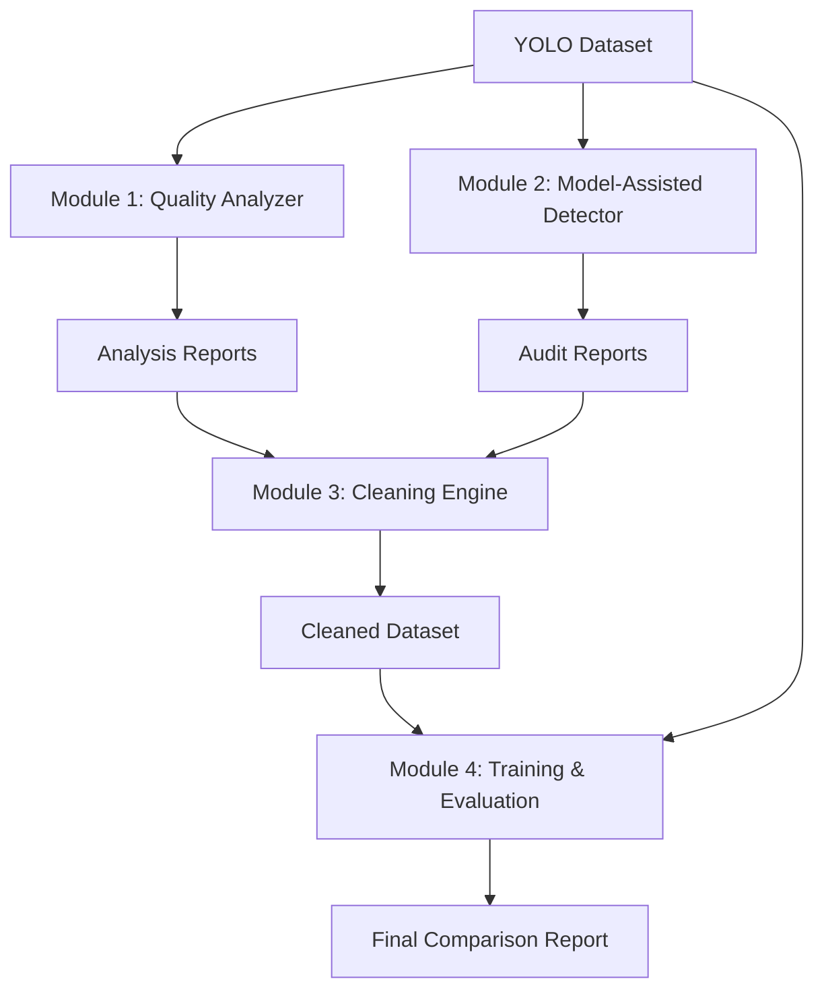

# Automated Annotation Quality Assurance & YOLO Retraining Pipeline

A modular, reproducible Python application that audits object detection datasets, detects annotation errors, generates a cleaned dataset, and measures the impact of annotation quality on YOLOv8 model performance.

## Project Overview

High-quality annotations are the foundation of robust computer vision models. However, real-world datasets frequently suffer from labeling errors such as missing objects, incorrect classes, shifted bounding boxes, and duplicates. This project provides a systematic, data-centric pipeline to identify, quantify, and mitigate these errors without requiring manual review of every single image.

## Problem Statement & Motivation

- **Problem**: Noisy annotations degrade model performance, but manual auditing of thousands of images is infeasible.
- **Motivation**: Automate the detection of suspicious annotations using geometric heuristics and model-assisted disagreement, then empirically prove that cleaning the dataset recovers lost model accuracy.

## Architecture

## Module Descriptions
1. **Dataset Quality Analyzer**: Rule-based geometric/statistical checks (invalid coordinates, tiny boxes, extreme aspect ratios, duplicates, class imbalance).
2. **Model-Assisted Detector**: Uses pretrained YOLOv8 to find disagreements via IoU-based greedy matching (missing annotations, class disagreements, localization issues).
3. **Dataset Cleaning Engine**: Generates a pristine copy of the dataset. Supports "conservative" (remove only objectively invalid boxes) and "aggressive" (remove suspicious/model-disputed boxes) modes. Preserves all splits; only modifies training labels.
4. **Training & Evaluation**: Executes a controlled 3-way experiment using identical hyperparameters and fresh weights, evaluating all models on the untouched validation set.

## Installation
git clone https://github.com/podiavaibhav/annotation-qa-yolo.git
cd annotation-qa-yolo
python3 -m venv venv
source venv/bin/activate
pip install -r requirements.txt

## Usage
**Run the complete pipeline**
python main.py run-all --data path/to/dataset/data.yaml
**Or run modules individually**
python main.py analyze --data path/to/dataset/data.yaml
python main.py detect --data path/to/dataset/data.yaml
python main.py clean --data path/to/dataset/data.yaml
python main.py train --data path/to/dataset/data.yaml

## Configuration
**All thresholds are in configs/default.yaml:**
*tiny_box_threshold: Minimum normalized area (default: 0.001)
*duplicate_iou_threshold: IoU threshold for duplicate detection (default: 0.98)
*cleaning_mode: conservative or aggressive
*seed: Random seed for reproducible noise injection (default: 42)

## Experiment Methodology
*Original: Train on the clean dataset.
*Noisy: Train on a synthetically corrupted copy (configurable probabilities for deletion, class flip, shift, resize, duplication).
*Cleaned: Train on the dataset after the Cleaning Engine has processed the noisy version.
All three models are evaluated on the exact same, untouched validation set.

## Limitations
*Model-assisted detection relies on the pretrained model's biases.
*Aggressive cleaning may remove legitimate small objects.
*Synthetic noise does not perfectly replicate human labeling errors.
